# Lab5Web - Praktikum 5: JavaScript Dasar

**Mata kuliah:** Pemrograman Web  
**Nama:** Alleizandro Lim Hianto Prasetya  
**NIM:** 312510395  
**Kelas:** I252A

## Tujuan

1. Memahami sintaks dasar JavaScript serta cara menghubungkannya dengan HTML.
2. Mempraktikkan output, variabel, operator, function, percabangan, dan perulangan.
3. Mengubah konten dan gaya HTML menggunakan DOM.
4. Membuat interaksi checkbox, kalkulator nilai, dan validasi form.

## Struktur berkas

```text
Lab5Web/
├── README.md
├── Laporan_Praktikum_5_JavaScript_Dasar.pdf
├── lab5_javascript/
│   ├── index.html
│   ├── script.js
│   └── style.css
└── screenshots/
    ├── 01-halaman-awal.png
    ├── 02-output-helloworld.png
    ├── 03-alert-prompt.png
    ├── 04-operasi-aritmetika.png
    ├── 05-if-else.png
    ├── 06-switch.png
    ├── 07-genap-ganjil.png
    ├── 08-ubah-warna.png
    ├── 09-checkbox-menu.png
    ├── 10-eksperimen.png
    ├── 11-kalkulator-nilai.png
    └── 12-validasi-form.png
```

## Cara menjalankan

1. Unduh atau clone repository `Lab5Web`.
2. Buka folder `lab5_javascript`.
3. Jalankan `index.html` menggunakan browser modern. Jika menggunakan VS Code, ekstensi Live Server juga dapat digunakan.
4. Tekan tombol pada tiap bagian untuk menguji latihan. Untuk melihat output `console.log()`, buka **Inspect/Periksa → Console** di browser.
5. Screenshot hasil uji sudah tersedia di folder `screenshots`.

## Langkah kerja dan hasil

### Latihan 1 - Menampilkan output
Mengubah teks elemen `#pesan` menjadi `Hello World` dan menampilkan pesan yang sama ke Console.

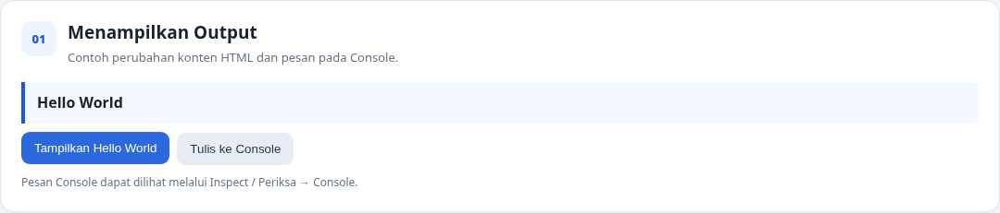

### Latihan 2 - Alert dan prompt
Tombol meminta nama melalui `prompt()`. Jika nama diisi, halaman menampilkan salam dan `alert()`; jika kosong atau dibatalkan, aplikasi memberikan pesan validasi.

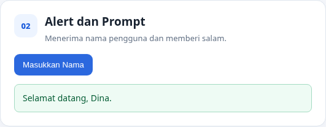

### Latihan 3 - Function dan operasi aritmetika
Function `operasiDasar(a, b)` menghitung penjumlahan, pengurangan, perkalian, pembagian, dan modulus. Pembagian dengan nol ditangani dengan pesan khusus.

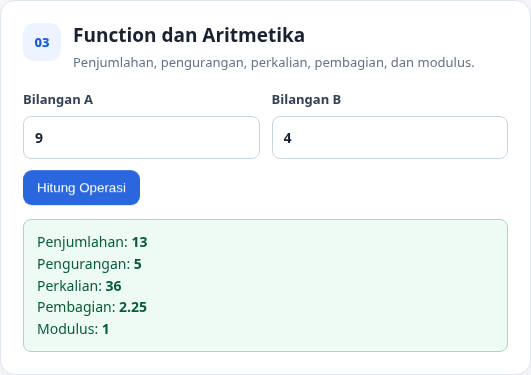

### Latihan 4 - Percabangan if-else
Program memeriksa input nilai. Nilai 60-100 dinyatakan lulus, nilai di bawah 60 belum lulus, dan input kosong atau di luar rentang 0-100 ditolak.

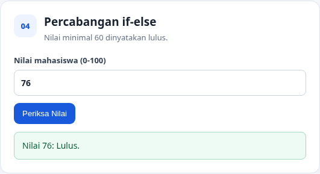

### Latihan 5 - Percabangan switch
Program mengubah pilihan 1-5 menjadi nama bilangan. Nilai selain pilihan yang tersedia menampilkan pesan `Pilihan tidak tersedia`.

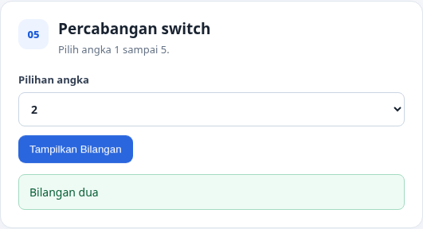

### Latihan 6 - Form bilangan genap atau ganjil
Program memeriksa apakah masukan berupa bilangan bulat, lalu menggunakan sisa bagi (`% 2`) untuk menentukan genap atau ganjil. Angka negatif dan nol juga dapat diuji.

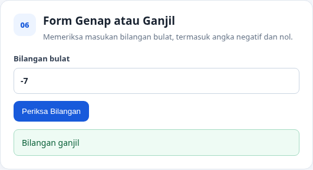

### Latihan 7 - Mengubah warna halaman
Tiga tombol memanggil satu function `ubahWarnaLatar(warna)` dengan parameter berbeda: `lightgreen`, `white`, dan `lightyellow`.

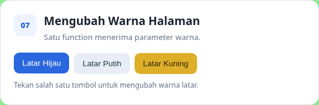

### Latihan 8 - DOM dan checkbox menu
Event `change` pada checkbox menghitung ulang total harga secara otomatis. Daftar menu juga dikembangkan dengan dua pilihan tambahan, yaitu tahu dan es teh.

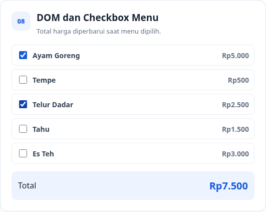

### Mini project - Kalkulator nilai mahasiswa
Perhitungan nilai akhir memakai bobot tugas 30%, UTS 30%, dan UAS 40%. Program menentukan predikat A-E serta status kelulusan (lulus jika nilai akhir minimal 60), dan memvalidasi setiap komponen pada rentang 0-100.

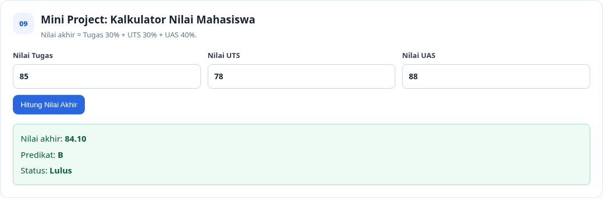

Contoh uji nilai Tugas 85, UTS 78, dan UAS 88 menghasilkan nilai akhir **84,10**, predikat **B**, dan status **Lulus**.

### Eksperimen mandiri dan validasi
Eksperimen mencakup tabel perkalian 7 dari 1 sampai 10, function `cekGenap(angka)`, dan tombol untuk menyembunyikan atau menampilkan elemen. Form validasi menolak nama kosong dan nilai di luar 0-100.

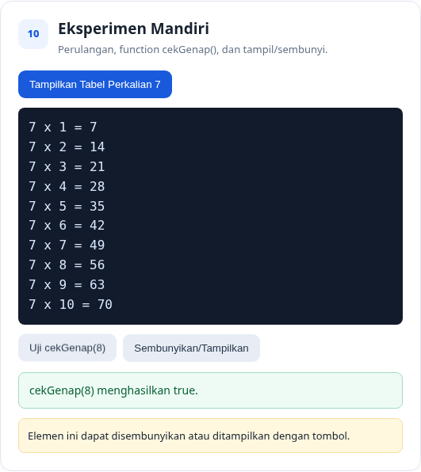

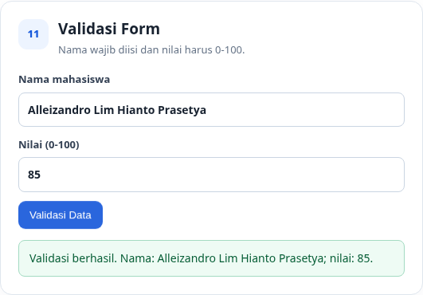

## Pertanyaan dan jawaban

### 1. Jelaskan perbedaan `console.log()`, `alert()`, `prompt()`, dan `textContent`/`innerHTML`.
- `console.log()` menampilkan informasi pada Console developer browser.
- `alert()` menampilkan dialog pesan yang harus ditutup pengguna.
- `prompt()` menampilkan dialog untuk meminta masukan teks dari pengguna, atau menghasilkan `null` jika dibatalkan.
- `textContent` membaca atau mengubah teks elemen. `innerHTML` membaca atau mengubah isi HTML elemen; jangan gunakan untuk memasukkan teks pengguna yang tidak tepercaya karena dapat menimbulkan risiko injeksi HTML.

### 2. Apa perbedaan `let` dan `const`? Berikan contoh.
`let` digunakan untuk variabel yang nilainya dapat ditetapkan ulang, sedangkan `const` digunakan untuk pengikatan yang tidak dapat ditetapkan ulang.

```javascript
let umur = 20;
umur = 21;
const nama = "Rani";
```

### 3. Apa perbedaan operator `==` dan `===`?
`==` membandingkan nilai dengan kemungkinan konversi tipe, sedangkan `===` membandingkan nilai sekaligus tipe tanpa konversi. Contohnya, `5 == "5"` bernilai `true`, tetapi `5 === "5"` bernilai `false`. Gunakan `===` sebagai pilihan umum agar perbandingan lebih eksplisit.

### 4. Jelaskan fungsi `if-else` dan `switch`. Kapan digunakan?
`if-else` digunakan untuk menguji kondisi logis atau rentang nilai, misalnya menentukan lulus jika nilai minimal 60. `switch` sesuai untuk memilih tindakan berdasarkan satu nilai dari beberapa pilihan tetap, misalnya pilihan angka 1 sampai 5.

### 5. Apa fungsi parameter dan `return` dalam function?
Parameter menerima nilai yang diberikan saat function dipanggil. `return` mengirimkan hasil kembali ke pemanggil dan mengakhiri eksekusi function tersebut.

```javascript
function hitungLuas(panjang, lebar) {
  return panjang * lebar;
}
const luas = hitungLuas(8, 4); // 32
```

### 6. Bagaimana JavaScript memilih elemen HTML menggunakan `document.getElementById()`?
Method tersebut mencari elemen berdasarkan atribut `id` dan mengembalikan elemen yang cocok, atau `null` jika tidak ditemukan. Contoh: `document.getElementById("pesan").textContent = "Halo!";` mengubah teks elemen yang memiliki `id="pesan"`.

### 7. Buat script untuk memvalidasi form agar nama tidak kosong dan nilai berada pada rentang 0-100.
Implementasi pada `script.js` menggunakan `.trim()` untuk memeriksa nama, lalu mengubah nilai menjadi angka serta memeriksa rentangnya.

```javascript
const nama = document.getElementById("namaValidasi").value.trim();
const nilaiTeks = document.getElementById("nilaiValidasi").value;
const nilai = Number(nilaiTeks);

if (nama === "") {
  hasil.textContent = "Nama tidak boleh kosong.";
} else if (nilaiTeks.trim() === "" || !Number.isFinite(nilai) || nilai < 0 || nilai > 100) {
  hasil.textContent = "Nilai harus berupa angka 0-100.";
} else {
  hasil.textContent = "Data valid.";
}
```

## Kesimpulan

Praktikum ini menerapkan dasar JavaScript, function, operasi aritmetika, percabangan, DOM, event listener, perulangan, manipulasi gaya, perhitungan nilai, dan validasi form. Seluruh contoh dapat diuji secara lokal melalui browser.

## Pengumpulan ke GitHub

```bash
git init
git add .
git commit -m "Praktikum 5 JavaScript Dasar"
git branch -M main
git remote add origin https://github.com/USERNAME/Lab5Web.git
git push -u origin main
```

Ganti `USERNAME` dengan nama akun GitHub dan buat repository bernama `Lab5Web` terlebih dahulu.
